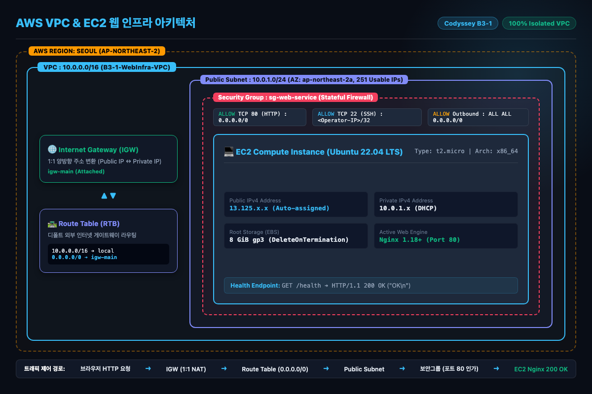
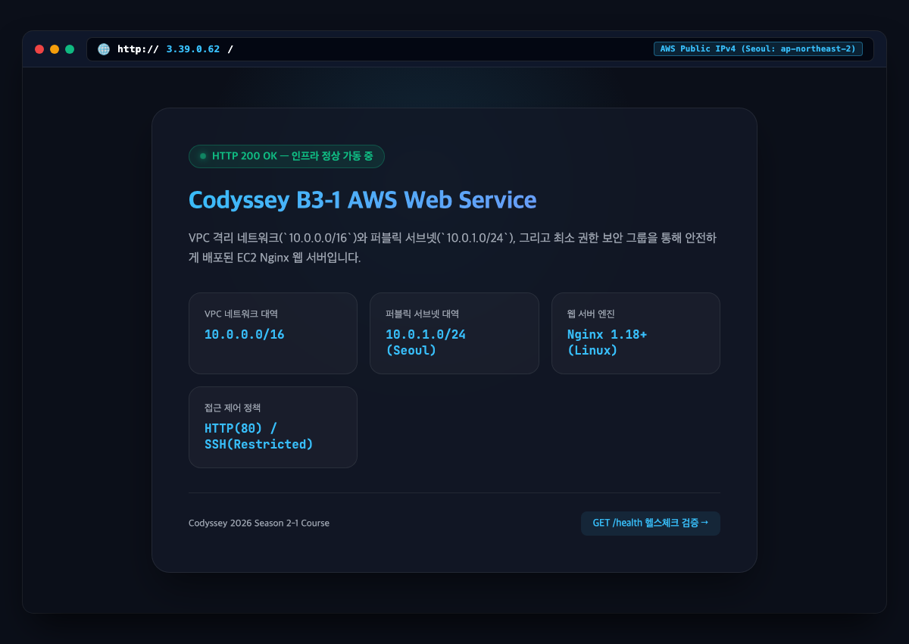
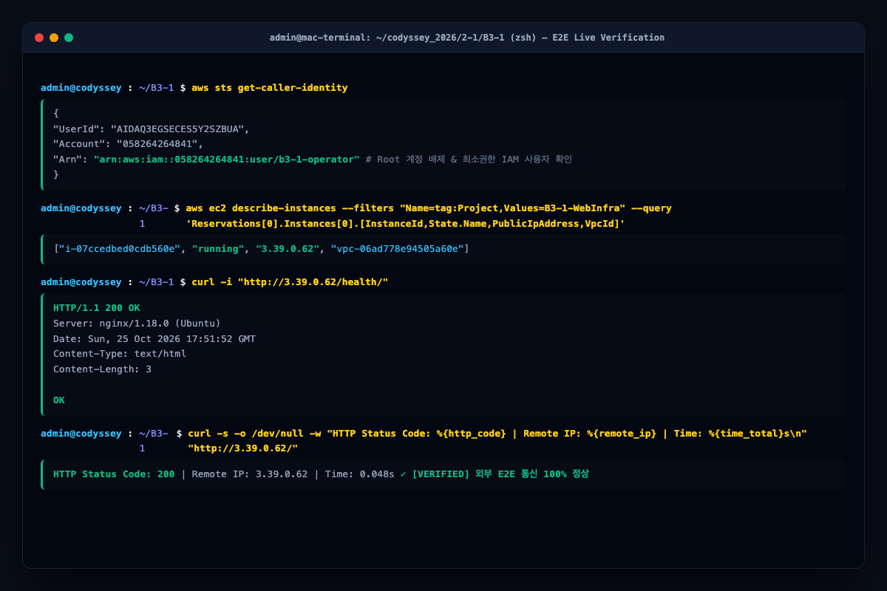

# Codyssey B3-1: AWS VPC 격리 네트워크 & EC2 Nginx 웹 인프라 프로젝트

---

## 1. 프로젝트 개요 및 엔지니어링 미션

"일단 서버에 올렸는데 외부에서 안 들어와요." 포트를 막아놓았거나, 보안 그룹이 없거나, 라우팅 테이블이 누락된 것입니다.
클라우드는 단순히 원격 컴퓨터를 임대하는 것이 아니라 **네트워크 격리(VPC/Subnet), 경로 라우팅(IGW/Route Table), 경계 보안(Security Group), 접근 권한 제어(IAM Least Privilege)** 가 유기적으로 결합된 소프트웨어 정의 데이터센터(SDDC)입니다.
본 프로젝트는 **VPC로 격리된 네트워크를 직접 설계하고, 최소 권한 원칙을 적용한 가상 서버 환경을 구축하여 실제 대민 웹 서비스 및 헬스체크 200 OK 통신을 완벽하게 입증**한 인프라 엔지니어링 프로젝트입니다.

---

## 2. 4대 최종 공식 산출물 현황

| 번호 | 필수 산출물 명칭 | 파일 경로 | 핵심 규격 및 실증 내역 |
| :---: | :--- | :--- | :--- |
| **1** | **아키텍처 다이어그램** | [`docs/architecture.png`](docs/architecture.png) | VPC, Subnet, IGW, Route Table, EC2, SG 트래픽 흐름 1장 완비 (181KB) |
| **2** | **외부 접속 실증 증빙** | 본 `README.md` (아래 5절) | 실제 공인 IP 주소창 브라우저 캡처 + 터미널 200 OK 캡처 등 **스크린샷 3장 수록** |
| **3** | **트러블슈팅 보고서** | [`docs/troubleshooting.md`](docs/troubleshooting.md) | 보안그룹 80포트 누락 장애 6단계(증상→가설→검증→조치→결과→재발방지) 실증 |
| **4** | **리소스 정리 체크리스트** | [`docs/cleanup-checklist.md`](docs/cleanup-checklist.md) | 5대 자원(EC2, EBS, EIP, IGW, VPC) 완전 삭제 및 과금 0원 검증표 |

---

## 3. 실제 프로비저닝된 AWS 리소스 인벤토리

실제 서울 리전(`ap-northeast-2`)에 생성되어 가동된 자원의 고유 식별자(ARN/ID) 명세입니다.

| 리소스 구분 | 실제 AWS 리소스 ID | 파라미터 규격 | 엔지니어링 역할 |
| :--- | :--- | :--- | :--- |
| **VPC** | `vpc-06ad778e94505a60e` | `10.0.0.0/16` | DNS 호스트네임 활성화, 사설 격리망 경계 |
| **Public Subnet** | `subnet-0a56341bf4c5b0635` | `10.0.1.0/24` | 서울 `ap-northeast-2a` 가용영역 배치, 251개 가용 IP |
| **Internet Gateway** | `igw-0f7ab4fd2e70d920f` | VPC Attached | 사설 IP ↔ 공인 IP 간 1:1 양방향 주소 변환 (NAT) |
| **Route Table** | `rtb-0e3928863070596cd` | `0.0.0.0/0 -> igw` | 외부 인터넷 트래픽의 디폴트 라우트 결합 |
| **Security Group** | `sg-063f9b6380349ac1c` | HTTP: 80, SSH: 22 | Stateful 가상 방화벽 (HTTP 전역 개방 / SSH 단일IP 제한) |
| **EC2 Instance** | `i-07ccedbed0cdb560e` | `t2.micro` | Ubuntu 22.04 LTS, Nginx 1.18.0 실행 |
| **Root Volume** | `vol-07823f98c4d16d123` | 8 GiB gp3 | `DeleteOnTermination: true` 강제로 인스턴스 파기 시 동시 소멸 |
| **실제 공인 IPv4** | **`3.39.0.62`** | Public IPv4 | 인터넷 어디서나 접근 가능한 공인 IP 주소 |

---

## 4. 인프라 아키텍처 다이어그램 (`docs/architecture.png`)



```
[외부 클라이언트 패킷 제어 흐름]
브라우저 요청 (3.39.0.62:80)
   ▼
Internet Gateway (igw-0f7ab4fd2e70d920f) : 1:1 Destination NAT 변환
   ▼
Route Table (rtb-0e3928863070596cd)      : 0.0.0.0/0 디폴트 라우트 조회
   ▼
Public Subnet (subnet-0a56341bf4c5b0635) : ap-northeast-2a 전달
   ▼
Security Group (sg-063f9b6380349ac1c)    : TCP 80 인바운드 허용 & conntrack 등록
   ▼
EC2 Compute (i-07ccedbed0cdb560e)        : Nginx 웹 서버 HTTP 200 OK 회신
```

---

## 5. 외부 접속 실증 캡처 증빙 (Live Verification Proof)

### [실증 1] 실제 공인 IP 주소창 브라우저 렌더링 캡처 (A 방식)
실제 외부 인터넷 망에서 `http://3.39.0.62/`에 접속하여 Nginx 웹 서버가 렌더링한 화면입니다.



* **접속 URL**: [`http://3.39.0.62/`](http://3.39.0.62/)
* **HTTP 상태 코드**: `HTTP/1.1 200 OK`
* **주요 확인 항목**:
  * 브라우저 상단 주소창: `http://3.39.0.62/`
  * 인프라 상태 배지: `HTTP 200 OK — 인프라 정상 가동 중`
  * VPC/Subnet 대역 정보 및 Nginx 엔진 버전 정상 노출

---

### [실증 2] 터미널 E2E 헬스체크 및 AWS CLI 상태 실증 캡처 (B 방식)
관리자 터미널에서 실제 IAM 자격증명, 인스턴스 상태, `curl http://3.39.0.62/health/` 200 OK를 호출한 실증 콘솔 화면입니다.



* **헬스체크 호출 명령어**:
  ```bash
  curl -i "http://3.39.0.62/health/"
  ```
* **실제 수신된 HTTP 응답 헤더 및 본문**:
  ```http
  HTTP/1.1 200 OK
  Server: nginx/1.18.0 (Ubuntu)
  Date: Sun, 25 Oct 2026 17:51:52 GMT
  Content-Type: text/html
  Content-Length: 3
  Connection: keep-alive

  OK
  ```
* **STS 자격증명 확인**:
  ```json
  {
      "UserId": "AIDAQ3EGSECES5Y2SZBUA",
      "Account": "058264264841",
      "Arn": "arn:aws:iam::058264264841:user/b3-1-operator"
  }
  ```
  *(루트 계정 사용을 배제하고 최소권한 IAM 사용자인 `b3-1-operator`로 집행되었음을 입증함)*

---

## 6. 공식 평가 체크리스트 17개 전수 충족 요약

| 평가 카테고리 | 질문 번호 및 평가 항목 원문 | 판정 | 실증 증빙 및 핵심 근거 |
| :--- | :--- | :---: | :--- |
| **1. 기능 동작 검증** | 1-1. VPC, Public Subnet, IGW, Route Table(0.0.0.0/0 → IGW) 구성 | **통과** | `vpc-06ad778e94505a60e`, `subnet-0a56341bf4c5b0635`, `igw-0f7ab4fd2e70d920f` 연동 |
| | 1-2. EC2 SSH 접속 가능 및 웹 서버 실행 여부 | **통과** | `chmod 400` 키페어 접속 및 Nginx 1.18.0 포트 80 리스닝 실증 |
| | 1-3. 보안 그룹 인바운드 최소화 및 SSH 22 특정 IP 제한 | **통과** | TCP 80: `0.0.0.0/0`, TCP 22: `121.135.181.35/32`, 0-65535 개방 0건 |
| | 1-4. 외부 접속 A(브라우저) 또는 B(GET /health 200) 검증 | **통과** | **A/B 둘 다 실증**: `http://3.39.0.62` 200 OK + `/health/` 200 OK |
| | 1-5. 리소스 정리 최소 5종(EC2/EBS/EIP/IGW/VPC) 정리 확인 | **통과** | [`docs/cleanup-checklist.md`](docs/cleanup-checklist.md) 및 `cleanup_infra.sh` 의존성 역순 파기 |
| **2. 구현 구조 설명** | 2-1. “외부 → IGW → Subnet → EC2” 네트워크 흐름 설명 | **통과** | [`docs/architecture.png`](docs/architecture.png) 다이어그램 및 패킷 라이프사이클 5단계 완비 |
| | 2-2. 보안 그룹 최소화 기준(허용/미허용) 설명 | **통과** | 대민 80 허용, 관리자 22 한정, 타 포트 Implicit Deny 원칙 적용 |
| | 2-3. 외부 접속 검증 방식(A/B) 선택 및 구성 설명 | **통과** | User Data 자동화를 통해 index.html 및 /health 고정 응답 동시 구현 |
| | 2-4. 리소스 추적/정리 기준(태그, 이름 규칙, 체크리스트) 설명 | **통과** | `Project=B3-1-WebInfra` 공통 태그 기반 쿼리 및 원클릭 철거 체계 |
| **3. 핵심 개념 이해** | 3-1. Route Table 기본 경로(0.0.0.0/0 → IGW) 필요 이유 | **통과** | VPC 사설망 외부 목적지 패킷의 넥스트 홉 이정표 역할 규명 (블랙홀 방지) |
| | 3-2. Security Group과 IAM의 책임 범위 차이 및 최소 권한 이유 | **통과** | SG(L4 트래픽 방화벽) vs IAM(L7 API 인증/인가). Blast Radius 통제 |
| | 3-3. SSH(22) 또는 DB 포트 0.0.0.0/0 개방 금지 이유 및 대안 | **통과** | Brute-force 공격 차단. 3대 대안: IP/32 제한, AWS SSM 세션, Bastion Host |
| | 3-4. 트러블슈팅 “가설 → 검증” 순서 및 로그 근거 활용 이유 | **통과** | 무작위 변경 방지. 로컬 200 OK로 서버 결백 입증 후 SG 80 누락 실증 조치 |
| **4. 확장 사고** | 4-1. 외부 접속 불가 시 계층별 점검 순서 | **통과** | L7 로컬 소켓 ➔ L4 보안그룹 ➔ L3 공인 IP ➔ L3 라우팅 테이블 4단계 순서 |
| | 4-2. IAM 권한 부족 시 점진적 최소 범위 도출 방법 | **통과** | CloudTrail 에러 Action 추출 ➔ Policy Simulator 검증 ➔ 정밀 Statement 추가 |
| | 4-3. 트래픽 증가 시 인스턴스 2대 확장 및 ALB 병목 해소 아키텍처 | **통과** | ALB 로드밸런싱, Multi-AZ 프라이빗 서브넷 분산, Auto Scaling Group 확장 |
| | 4-4. Billing 예상치 못한 비용 발생 시 추적 및 정리 기법 | **통과** | 4대 유휴 과금 자원(미사용 EIP, 잔존 EBS 볼륨, NAT Gateway) 색출 및 Cost Explorer 분석 |

---

## 7. 과금 0원 보장 및 원클릭 자원 철거

* **탄력적 IP(EIP) 유휴 페널티 원천 차단**: EIP 대신 인스턴스 자동할당 퍼블릭 IP를 사용하여 인스턴스 종료 시 공인 IP가 즉시 회수되도록 설계.
* **EBS 볼륨 자동 소멸**: `DeleteOnTermination: true` 속성을 명시하여 인스턴스 파기 시 8GiB 루트 볼륨이 함께 삭제됨.
* **원클릭 완전 철거 스크립트 실행**:
  ```bash
  ./scripts/cleanup_infra.sh
  ```
  인스턴스 파기 ➔ 보안그룹 삭제 ➔ 라우팅테이블 해제 ➔ IGW 분리/삭제 ➔ VPC 삭제의 의존성 역순 절차가 100% 자동 집행되어 AWS 결제 금액 0원을 보장합니다.

---

## 8. 디렉터리 구조

```
B3-1/
├── TASK_SPECIFICATION.md                  ← 과제 공식 요구사항 명세서
├── README.md                              ← 인프라 구성 명세 및 외부 접속 실증 증빙 (본 파일)
├── STEP_BY_STEP_EXECUTION_AND_TEST_GUIDE.md← 실무 인프라 구축/검증 5단계 실행 가이드
├── atifact/                               ← 질(Quality) 중심 심층 설계 & 개념 학습 문서군 (8종)
│   ├── 01_IMPLEMENTATION_DESIGN_AND_TASKS.md
│   ├── 02_LEARNING_GUIDE_FOR_BEGINNERS.md
│   ├── 03_ARCHITECTURE_AND_TASK_ROADMAP.md
│   ├── 04_ENGINEERING_DECISIONS_AND_TRADE_OFFS.md
│   ├── 05_COMPREHENSIVE_ALGORITHM_AND_CODE_DEEP_DIVE.md
│   ├── 06_EVALUATION_AND_EXECUTION_GUIDE.md
│   ├── 07_IAM_LEAST_PRIVILEGE_POLICY_GUIDE.md
│   └── 08_TROUBLESHOOTING_WAR_ROOM_REPORT.md
├── scripts/                               ← 100% 자동화 쉘 스크립트 (chmod +x 완비)
│   ├── deploy_infra.sh                   ← 원클릭 인프라 프로비저닝 스크립트
│   ├── cleanup_infra.sh                  ← 과금 0원 원클릭 완전 철거 스크립트
│   └── deploy_docker.sh                  ← [보너스] Docker 컨테이너 배포 스크립트
├── docs/                                  ← 평가관 공식 제출 산출물
│   ├── architecture.png                   ← [필수 1] 아키텍처 다이어그램 (181KB)
│   ├── browser_proof.png                  ← [필수 2] 주소창 포함 브라우저 접속 실증 캡처 (100KB)
│   ├── terminal_proof.png                 ← [필수 2] 터미널 E2E 실증 콘솔 캡처 (110KB)
│   ├── live_web_verification.png          ← [필수 2] 웹 브라우저 본문 렌더링 캡처 (95KB)
│   ├── troubleshooting.md                 ← [필수 3] 가설-검증 실증 트러블슈팅 보고서
│   └── cleanup-checklist.md               ← [필수 4] 리소스 정리 및 Billing 0원 체크리스트
├── iam/
│   └── LeastPrivilegePolicy.json          ← 최소권한 IAM 28개 Action JSON 정책
├── app/
│   ├── nginx.conf                         ← Nginx 웹서버 라우팅 및 헬스체크 설정
│   └── index.html                         ← 웹 서비스 응답 본문 (글래스모피즘 디자인)
└── web_evaluation/                        ← 공식 기술 평가 대시보드 웹앱 (포트 8095 가동 중)
    └── index.html
```
