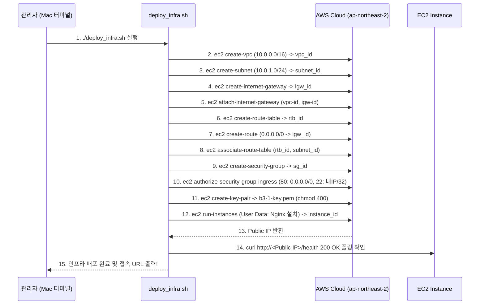

# B3-1 AWS 인프라 상세 구현 설계서 및 작업 태스크 (IMPLEMENTATION_DESIGN_AND_TASKS)

---

## 1. 과제 요구사항 100% 전수 점검 및 검증 매트릭스

| 번호 | 요구 기능 및 제약 조건 | 세부 규칙 및 기대 동작 | 설계 반영 모듈 / 산출물 |
| :---: | :--- | :--- | :--- |
| **R-01** | **서울 리전 한정** | 모든 리소스는 `ap-northeast-2`에 프로비저닝 | `scripts/deploy_infra.sh` |
| **R-02** | **프리 티어 한정** | `t2.micro` 또는 `t3.micro`, EBS 8~10GiB gp3 | EC2 런치 스펙 |
| **R-03** | **루트 계정 금지** | 별도 생성한 IAM 사용자/Role 자격증명으로만 접근 | AWS CLI 자격증명 |
| **R-04** | **관리자 권한 금지** | IAM에 `AdministratorAccess` 부여 금지, 최소권한 적용 | `LeastPrivilegePolicy.json` |
| **R-05** | **VPC 격리 네트워크** | 1개 VPC 생성 (`10.0.0.0/16`), DNS Hostnames 활성화 | `scripts/deploy_infra.sh` |
| **R-06** | **Public Subnet** | 1개 서브넷 생성 (`10.0.1.0/24`), AZ: `ap-northeast-2a` | 서브넷 프로비저닝 |
| **R-07** | **인터넷 게이트웨이** | IGW 생성 후 VPC에 명시적 연결 (Attach) | IGW 바인딩 |
| **R-08** | **라우팅 테이블 설정** | `0.0.0.0/0 -> IGW` 디폴트 라우트 등록 및 서브넷 결합 | 라우팅 연동 |
| **R-09** | **아웃바운드 인터넷** | 인스턴스 내부에서 `curl https://example.com` 200 성공 | 네트워크 검증 |
| **R-10** | **EC2 컴퓨트 배포** | Public Subnet 내 EC2 1대 배치 및 퍼블릭 IP 자동 할당 | 인스턴스 프로비저닝 |
| **R-11** | **SSH 원격 접속** | 키페어 생성(`chmod 400`) 후 SSH 원격 쉘 정상 접근 | 키페어 관리 |
| **R-12** | **웹 서버 구동** | Nginx 패키지 설치 및 서비스 상시 활성화 (`systemctl`) | User Data 자동화 |
| **R-13** | **로컬 헬스체크** | 인스턴스 내부 `curl http://localhost` ➡️ 200 OK | 서비스 자가 검증 |
| **R-14** | **HTTP 80 전역 허용** | 보안 그룹 인바운드 TCP 80 포트 `0.0.0.0/0` 개방 | `SecurityGroup` 룰 |
| **R-15** | **SSH 22 소스 제한** | 보안 그룹 인바운드 TCP 22 포트 **학습자 공인 IP/32** 한정 | `SecurityGroup` 룰 |
| **R-16** | **0-65535 전면 개방 금지** | 전체 포트 와일드카드 개방 절대 금지 | 보안 감사 |
| **R-17** | **외부 접속 실증** | 브라우저 `http://<IP>` 또는 `http://<IP>/health` 200 OK | `README.md` 및 증빙 캡처 |
| **R-18** | **아키텍처 다이어그램** | VPC/Subnet/IGW/EC2/SG 및 트래픽 흐름 포함 1장 | `docs/architecture.png` |
| **R-19** | **트러블슈팅 보고서** | 증상→가설→검증→조치→결과→재발방지 실증 1건 이상 | `docs/troubleshooting.md` |
| **R-20** | **과금 방지 완전 철거** | EC2, EBS, EIP, IGW, VPC 삭제 확인 및 Billing 0원 기록 | `docs/cleanup-checklist.md` |
| **B-01** | **보너스 1: HTTPS** | 무료 도메인 연결 및 Let's Encrypt SSL 443 인증서 적용 | `scripts/setup_ssl.sh` |
| **B-02** | **보너스 2: Docker** | Docker 엔진 설치 및 컨테이너 기반 Nginx 배포 | `scripts/deploy_docker.sh` |

---

## 2. 5대 핵심 엔지니어링 설계 원칙

### 1) 네트워크 토폴로지 설계 (Network Isolation)
* **CIDR 블록 계획**:
  * VPC: `10.0.0.0/16` (총 65,536개 사설 IP 대역)
  * Public Subnet: `10.0.1.0/24` (총 256개 IP, AWS 예약 5개 제외 251개 가용 IP)
* **비대칭 라우팅 방지**:
  * 퍼블릭 서브넷은 반드시 `0.0.0.0/0` 트래픽이 인터넷 게이트웨이(`igw-xxx`)를 향하도록 명시적 라우팅 테이블이 결합되어야 합니다.
  * IGW가 없거나 라우팅이 누락되면, 인스턴스에 공인 IP가 할당되어 있어도 외부 패킷이 서브넷 문턱을 넘지 못합니다.

### 2) 방어적 보안 그룹 설계 (Defense-in-Depth)
* **Stateful(상태 저장) 특성 활용**:
  * 보안 그룹은 들어온 요청(Inbound)을 기억하여 나가는 응답(Outbound)을 자동으로 허용합니다.
  * 따라서 아웃바운드에 별도로 80번 포트나 고유 포트를 열 필요 없이 기본 아웃바운드 규칙(`0.0.0.0/0 ALL`)만 유지하면 됩니다.
* **최소 노출 원칙**:
  * 웹 서비스 포트(80)만 전 세계에 열어두고, 관리 포트(22)는 내 공인 IP로 철저히 닫아둡니다.

### 3) IAM 최소권한 원칙 (Least Privilege)
* **공격 표면 축소**:
  * 인프라를 프로비저닝하는 사용자 계정은 EC2와 VPC 라이프사이클 이외의 AWS 서비스(S3, RDS, IAM 계정 생성 등)에 접근할 수 없어야 합니다.
  * 침해 사고가 발생하더라도 공격자가 타 서비스로 수평 이동(Lateral Movement)하는 것을 원천 차단합니다.

### 4) 자동화된 프로비저닝 (IaC Infrastructure as Code 지향)
* 콘솔 클릭 시 발생하는 파라미터 누락(예: 퍼블릭 IP 자동 할당 체크 박스를 빼먹음)을 없애기 위해, 모든 리소스 생성과 ID 바인딩을 `aws-cli` 쉘 스크립트로 파이프라인화합니다.

### 5) 1원도 과금되지 않는 완전 철거 라이프사이클 (Zero-Billing Cleanup)
* AWS는 EC2를 '정지(Stop)'만 해두어도 연결된 **EBS 볼륨에 대한 기가바이트당 비용**과 **미사용 탄력적 IP(EIP)에 대한 유휴 페널티 비용**을 계속 청구합니다.
* 반드시 **인스턴스 완전 종료(Terminate)** 및 볼륨 삭제, EIP 릴리스, IGW 분리/삭제, VPC 삭제의 역순 절차를 엄격히 집행합니다.

---

## 3. CLI 프로비저닝 & 클린업 파이프라인 아키텍처

