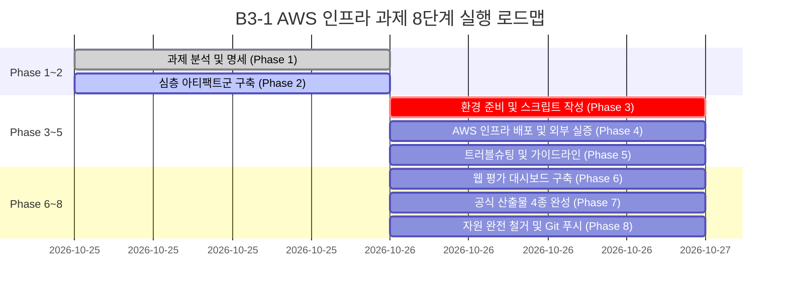

# B3-1 AWS 인프라 아키텍처 및 상세 실행 로드맵 (ARCHITECTURE_AND_TASK_ROADMAP)

---

## 1. 개요

본 문서는 B3-1 과제에서 구축하는 클라우드 인프라의 **전체 네트워크 토폴로지, OSI 7계층 기반 패킷 제어 흐름, IP 주소 체계 및 데이터 변환 매트릭스, 그리고 단계별 실행 로드맵**을 엔지니어링 관점에서 심층 기술합니다.

---

## 2. 클라우드 네트워크 아키텍처 다이어그램 (Topology)

```
+---------------------------------------------------------------------------------------------------+
| AWS Cloud (Seoul Region: ap-northeast-2)                                                          |
|                                                                                                   |
|  +---------------------------------------------------------------------------------------------+  |
|  | VPC (Virtual Private Cloud) : 10.0.0.0/16                                                   |  |
|  | DNS Resolution: Enabled | DNS Hostnames: Enabled                                            |  |
|  |                                                                                             |  |
|  |   +---------------------------------------------------------------------------------------+ |  |
|  |   | Public Subnet (AZ: ap-northeast-2a) : 10.0.1.0/24 (Total 256 IPs / 251 Usable)        | |  |
|  |   | Associated Route Table: rtb-custom                                                    | |  |
|  |   |   - 10.0.0.0/16 -> local                                                              | |  |
|  |   |   - 0.0.0.0/0   -> igw-main                                                           | |  |
|  |   |                                                                                       | |  |
|  |   |   +-------------------------------------------------------------------------------+   | |  |
|  |   |   | Security Group : sg-web-service                                               |   | |  |
|  |   |   | Inbound:                                                                      |   | |  |
|  |   |   |   - TCP 80  (HTTP)  : 0.0.0.0/0       (Public Internet Access)                |   | |  |
|  |   |   |   - TCP 22  (SSH)   : <Operator-IP>/32(Admin Bastion Restrict)                |   | |  |
|  |   |   | Outbound:                                                                     |   | |  |
|  |   |   |   - ALL ALL (Any)   : 0.0.0.0/0       (Yum/Apt Updates & Outbound Traffic)    |   | |  |
|  |   |   |                                                                               |   | |  |
|  |   |   |   +-----------------------------------------------------------------------+   | |  |
|  |   |   |   | EC2 Instance (t2.micro / t3.micro, Ubuntu 22.04 LTS)                  |   | |  |
|  |   |   |   | Private IPv4: 10.0.1.x (DHCP Assigned)                               |   | |  |
|  |   |   |   | Public IPv4 : 13.125.x.x (Auto-assigned via IGW 1:1 NAT)              |   | |  |
|  |   |   |   | Root EBS    : 8~10 GiB gp3 (DeleteOnTermination: true)                 |   | |  |
|  |   |   |   |                                                                       |   | |  |
|  |   |   |   |   [OS Level Services]                                                 |   | |  |
|  |   |   |   |   - Systemd Service: nginx.service (Active: running)                  |   | |  |
|  |   |   |   |   - Listening Ports: 0.0.0.0:80 (Nginx), 0.0.0.0:22 (sshd)           |   | |  |
|  |   |   |   |   - Health Endpoint: GET /health -> HTTP 200 OK                       |   | |  |
|  |   |   |   +-----------------------------------------------------------------------+   | |  |
|  |   |   +-------------------------------------------------------------------------------+   | |  |
|  |   +---------------------------------------------------------------------------------------+ |  |
|  |                               ▲                                                             |  |
|  |                               │ Route: 0.0.0.0/0 via igw-main                               |  |
|  |                               ▼                                                             |  |
|  |   +---------------------------------------------------------------------------------------+ |  |
|  |   | Internet Gateway (IGW) : igw-main (1:1 Bidirectional Stateless NAT)                   | |  |
|  |   +---------------------------------------------------------------------------------------+ |  |
|  +-------------------------------------------------------▲-------------------------------------+  |
+----------------------------------------------------------│----------------------------------------+
                                                           │
                                                           ▼ Public Internet (WAN)
                                             +---------------------------+
                                             | Operator / Client Browser |
                                             | Source IP: <Client-IP>    |
                                             +---------------------------+
```

---

## 3. OSI 7계층 기준 패킷 흐름 및 프로토콜 분석

외부 클라이언트가 브라우저에서 `http://13.125.x.x/`로 접속할 때, 패킷이 처리되는 각 계층별 상세 메커니즘입니다.

| OSI 계층 | 처리 장비 / 모듈 | 수행되는 네트워크 동작 및 프로토콜 규격 | 핵심 검증 포인트 |
| :--- | :--- | :--- | :--- |
| **L7 (Application)** | Nginx Web Server | HTTP/1.1 프로토콜 파싱 (`GET /health HTTP/1.1`)<br>`location /health` 블록 매칭 ➔ `HTTP/1.1 200 OK` 응답 헤더 및 바디 작성 | `curl -i http://localhost/health` ➔ 200 OK |
| **L4 (Transport)** | Linux TCP Stack & Security Group | TCP 3-Way Handshake (`SYN ➔ SYN-ACK ➔ ACK`) 수행.<br>Security Group 인바운드 TCP 80 허용 검사 및 연결 추적(conntrack) 등록 | 소켓 바인딩 확인 (`ss -tlpn \| grep 80`) |
| **L3 (Network)** | IGW & VPC 가상 라우터 | IP 헤더 처리.<br>1) IGW에서 Destination NAT: 목적지 IP `13.125.x.x` ➔ `10.0.1.x`<br>2) Route Table 조회: 서브넷 라우팅 테이블의 로컬 경로 확인 및 전달 | IP 라우팅 확인 (`ip route show`) |
| **L2 (Data Link)** | AWS Nitro Hypervisor / ENI | 이더넷 프레임 캡슐화. 가상 네트워크 인터페이스(ENI) MAC 주소 기반 패킷 스위칭 | ENI 상태 확인 (`DescribeNetworkInterfaces`) |

---

## 4. CIDR 및 IP 주소 체계 상세 분석

### 1) 서브넷 마스킹 계산
- **VPC CIDR (`10.0.0.0/16`)**:
  - 서브넷 마스크: `255.255.0.0`
  - 전체 가용 IP 수: $2^{(32-16)} = 2^{16} = 65,536$ 개
  - 범위: `10.0.0.0` ~ `10.0.255.255`
- **Public Subnet CIDR (`10.0.1.0/24`)**:
  - 서브넷 마스크: `255.255.255.0`
  - 전체 IP 수: $2^{(32-24)} = 2^8 = 256$ 개
  - 범위: `10.0.1.0` ~ `10.0.1.255`

### 2) AWS 서브넷 내 5대 예약 IP 구조
AWS는 서브넷마다 기본적으로 5개의 IP를 시스템 제어용으로 강제 예약하므로, 실제 인스턴스에 할당 가능한 IP는 **251개**입니다.

| IP 주소 | 예약 명칭 | 실제 역할 및 비즈니스 목적 |
| :--- | :--- | :--- |
| `10.0.1.0` | Network Address | 서브넷 자체를 식별하는 네트워크 주소 (호스트 할당 불가) |
| `10.0.1.1` | VPC Virtual Router | 가상 라우터 주소 (서브넷 내 모든 트래픽의 기본 게이트웨이) |
| `10.0.1.2` | AWS DNS Server | Amazon Provided DNS (Route 53 Resolver) 주소 |
| `10.0.1.3` | AWS Future Use | AWS 내부 인프라 확장을 위한 예비 주소 |
| `10.0.1.255` | Broadcast Address | 브로드캐스트 주소 (AWS VPC는 유니캐스트만 지원하지만 RFC 표준상 예약) |

---

## 5. 데이터 변환 매트릭스 (NAT & Packet Inspection)

외부 클라이언트(`211.200.50.10:54321`)가 EC2 웹 서버(`10.0.1.50:80`, 공인 IP `13.125.100.200`)와 통신할 때의 헤더 변환 추적표입니다.

```
[인바운드 요청 패킷의 변환 흐름]
1. 클라이언트 출발 : [Src: 211.200.50.10:54321] -> [Dst: 13.125.100.200:80]
2. IGW 통과 후     : [Src: 211.200.50.10:54321] -> [Dst: 10.0.1.50:80] (1:1 DNAT 발생)
3. EC2 수신        : 10.0.1.50의 80번 포트(Nginx)로 전달

[아웃바운드 응답 패킷의 변환 흐름]
1. EC2 응답 송신   : [Src: 10.0.1.50:80] -> [Dst: 211.200.50.10:54321]
2. IGW 통과 후     : [Src: 13.125.100.200:80] -> [Dst: 211.200.50.10:54321] (1:1 SNAT 발생)
3. 클라이언트 수신 : 자신의 요청 대상이었던 13.125.100.200으로부터 응답을 받아 연결 정상 성립
```

---

## 6. 과제 수행 8단계 로드맵 (Phase Roadmap)



| Phase | 마일스톤 | 필수 산출물 및 완료 기준 |
| :--- | :--- | :--- |
| **Phase 1** | 과제 요구사항 분석 | `B3-1/TASK_SPECIFICATION.md` 작성 완료 |
| **Phase 2** | 질 중심 설계 아티팩트군 | `atifact/01~08.md` 8종 문서 완전 구축 |
| **Phase 3** | 인프라 자동화 코드 구현 | `scripts/deploy_infra.sh`, `scripts/cleanup_infra.sh`, `app/nginx.conf` |
| **Phase 4** | 인프라 배포 및 외부 실증 | AWS CLI 기반 배포 실행 및 `http://<IP>/health` 200 OK 응답 획득 |
| **Phase 5** | 트러블슈팅 보고서 | `STEP_BY_STEP_EXECUTION_AND_TEST_GUIDE.md`, 장애 실증 케이스 도출 |
| **Phase 6** | 평가 대시보드 | `web_evaluation/index.html` 모던 웹 평가 뷰어 구축 |
| **Phase 7** | 4대 공식 산출물 | `docs/architecture.png`, `docs/troubleshooting.md`, `docs/cleanup-checklist.md`, `README.md` |
| **Phase 8** | 완전 철거 및 원격 푸시 | 5대 리소스 0원 삭제 검증, Git 커밋 및 `newcode99/Codyssey` 원격 푸시 |
