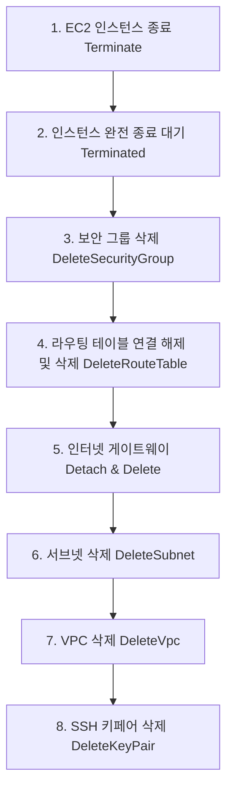

# B3-1 인프라 자동화 코드 및 웹서버 설정 심층 해부 (COMPREHENSIVE_ALGORITHM_AND_CODE_DEEP_DIVE)

---

## 1. 개요

본 문서는 B3-1 과제의 핵심 구현체인 **인프라 프로비저닝 스크립트(`deploy_infra.sh`), 과금 방지 완전 철거 스크립트(`cleanup_infra.sh`), Nginx 웹 서버 설정(`nginx.conf`)**의 소스코드를 라인 바이 라인으로 분석하고, 각 로직의 **Algorithm(동작 알고리즘), Why(기술적 근거), Guard(방어 및 예외 처리)** 3축을 심층 해부합니다.

---

## 2. 배포 자동화 파이프라인 (`scripts/deploy_infra.sh`) 라인별 해부

### [섹션 1] 환경 변수 정의 및 공인 IP 자동 획득

```bash
#!/usr/bin/env bash
set -euo pipefail

REGION="ap-northeast-2"
VPC_CIDR="10.0.0.0/16"
SUBNET_CIDR="10.0.1.0/24"
AZ="${REGION}a"
INSTANCE_TYPE="t2.micro"
KEY_NAME="b3-1-keypair"
TAG_PROJECT="B3-1-WebInfra"

# 배포자 공인 IP 동적 추출
MY_IP=$(curl -s --connect-timeout 5 https://checkip.amazonaws.com || curl -s --connect-timeout 5 https://api.ipify.org)
if [[ -z "${MY_IP}" ]]; then
  echo "[ERROR] 공인 IP를 조회할 수 없습니다. 네트워크 연결을 확인하십시오." >&2
  exit 1
fi
echo "[INFO] 관리자 공인 IP 확인: ${MY_IP}/32"
```

- **Algorithm (동작 알고리즘)**:
  `set -euo pipefail`로 예기치 않은 오류나 미정의 변수 참조 시 스크립트를 즉각 중단합니다. 이후 서울 리전(`ap-northeast-2`)과 네트워크 CIDR 규격을 상수로 선언하고, 외부 서비스(`checkip.amazonaws.com` 등)를 호출하여 현재 터미널이 위치한 관리자의 공인 IP를 자동 획득합니다.
- **Why (선택 이유)**:
  관리자 IP를 하드코딩하면 카페, 집, 사무실 등 작업 장소가 바뀔 때마다 SSH 22 포트 규칙이 불일치하여 접속 불가 장애가 발생합니다. 동적 조회를 통해 항상 실행 시점의 IP로 보안 그룹을 정밀 설정합니다.
- **Guard (방어 로직)**:
  1차 IP 확인 서비스 장애를 대비해 `||` 연산자로 보조 서비스(`ipify.org`)를 폴백(Fallback) 지정했으며, 둘 다 실패하여 빈 문자열이 될 경우 스크립트를 조기 종료(`exit 1`)하여 잘못된 보안 그룹 생성을 방지합니다.

---

### [섹션 2] VPC, 서브넷, 인터넷 게이트웨이(IGW) 프로비저닝

```bash
# 1. VPC 생성 및 태깅
VPC_ID=$(aws ec2 create-vpc \
  --cidr-block "${VPC_CIDR}" \
  --region "${REGION}" \
  --tag-specifications "ResourceType=vpc,Tags=[{Key=Name,Value=${TAG_PROJECT}-VPC}]" \
  --query 'Vpc.VpcId' --output text)

aws ec2 modify-vpc-attribute --vpc-id "${VPC_ID}" --enable-dns-hostnames "{\"Value\":true}" --region "${REGION}"
aws ec2 modify-vpc-attribute --vpc-id "${VPC_ID}" --enable-dns-support "{\"Value\":true}" --region "${REGION}"

# 2. Public Subnet 생성
SUBNET_ID=$(aws ec2 create-subnet \
  --vpc-id "${VPC_ID}" \
  --cidr-block "${SUBNET_CIDR}" \
  --availability-zone "${AZ}" \
  --region "${REGION}" \
  --tag-specifications "ResourceType=subnet,Tags=[{Key=Name,Value=${TAG_PROJECT}-Subnet}]" \
  --query 'Subnet.SubnetId' --output text)

# 3. Internet Gateway 생성 및 VPC 바인딩
IGW_ID=$(aws ec2 create-internet-gateway \
  --region "${REGION}" \
  --tag-specifications "ResourceType=internet-gateway,Tags=[{Key=Name,Value=${TAG_PROJECT}-IGW}]" \
  --query 'InternetGateway.InternetGatewayId' --output text)

aws ec2 attach-internet-gateway --vpc-id "${VPC_ID}" --internet-gateway-id "${IGW_ID}" --region "${REGION}"
```

- **Algorithm (동작 알고리즘)**:
  AWS EC2 CLI를 통해 1개 VPC(`10.0.0.0/16`)를 생성하고, DNS 호스트네임 및 DNS 지원 속성을 활성화합니다. 이어서 서울 리전 `a` 가용영역에 서브넷(`10.0.1.0/24`)을 생성하고, 독립 생성된 IGW를 VPC에 결합(`attach`)합니다.
- **Why (선택 이유)**:
  `--enable-dns-hostnames`를 켜지 않으면 인스턴스에 공인 IP가 부여되어도 퍼블릭 DNS 이름(`ec2-xx-xx.compute.amazonaws.com`)이 생성되지 않아 일부 웹 서비스나 모니터링 연동에 지장을 줍니다.
- **Guard (방어 로직)**:
  모든 생성 명령어에 `--query ... --output text`를 명시하여 CLI 출력 JSON에서 필요한 ID만 정제하여 쉘 변수에 안전하게 바인딩합니다. 또한 리소스마다 고유 태그(`Name`)를 부여하여 추후 철거 스크립트에서 식별 누락을 방지합니다.

---

### [섹션 3] 커스텀 라우팅 테이블 생성 및 서브넷 결합

```bash
# 4. Route Table 생성 및 0.0.0.0/0 -> IGW 라우팅 등록
RTB_ID=$(aws ec2 create-route-table \
  --vpc-id "${VPC_ID}" \
  --region "${REGION}" \
  --tag-specifications "ResourceType=route-table,Tags=[{Key=Name,Value=${TAG_PROJECT}-RTB}]" \
  --query 'RouteTable.RouteTableId' --output text)

aws ec2 create-route \
  --route-table-id "${RTB_ID}" \
  --destination-cidr-block "0.0.0.0/0" \
  --gateway-id "${IGW_ID}" \
  --region "${REGION}" >/dev/null

aws ec2 associate-route-table \
  --route-table-id "${RTB_ID}" \
  --subnet-id "${SUBNET_ID}" \
  --region "${REGION}" >/dev/null
```

- **Algorithm (동작 알고리즘)**:
  전용 라우팅 테이블을 생성하고, 디폴트 목적지인 `0.0.0.0/0`에 대한 넥스트 홉(Next Hop)을 직전에 생성한 IGW ID로 지정합니다. 마지막으로 이 라우팅 테이블을 퍼블릭 서브넷과 명시적으로 결합(`associate`)합니다.
- **Why (선택 이유)**:
  서브넷 생성만으로는 인터넷과 통신할 수 없습니다. 서브넷 라우팅 테이블에 IGW로 나가는 경로가 등록되어야만 비로소 '퍼블릭 서브넷'으로서의 생명력을 얻게 됩니다.
- **Guard (방어 로직)**:
  VPC의 기본 라우팅 테이블(Main Route Table)을 오염시키지 않고 별도의 커스텀 라우팅 테이블을 생성하여 격리함으로써, 향후 추가될 수 있는 프라이빗 서브넷이 원치 않게 외부 인터넷에 노출되는 아키텍처 오염을 원천 방지합니다.

---

### [섹션 4] 보안 그룹 생성 및 화이트리스트 규칙 적용

```bash
# 5. Security Group 생성
SG_ID=$(aws ec2 create-security-group \
  --group-name "${TAG_PROJECT}-SG" \
  --description "Security Group for B3-1 Web Infrastructure" \
  --vpc-id "${VPC_ID}" \
  --region "${REGION}" \
  --query 'GroupId' --output text)

# HTTP 80: 전 세계 허용 (웹 서비스)
aws ec2 authorize-security-group-ingress \
  --group-id "${SG_ID}" \
  --protocol tcp --port 80 --cidr "0.0.0.0/0" \
  --region "${REGION}" >/dev/null

# SSH 22: 오직 관리자 본인 IP만 허용 (0-65535 전면 개방 금지 준수)
aws ec2 authorize-security-group-ingress \
  --group-id "${SG_ID}" \
  --protocol tcp --port 22 --cidr "${MY_IP}/32" \
  --region "${REGION}" >/dev/null
```

- **Algorithm (동작 알고리즘)**:
  VPC 내부에 새 보안 그룹을 생성하고, 인바운드 규칙으로 포트 80(HTTP)은 `0.0.0.0/0` 전체 공개, 포트 22(SSH)는 관리자 공인 IP인 `${MY_IP}/32` 단일 호스트로 한정 등록합니다.
- **Why (선택 이유)**:
  과제 필수 제약 조건인 "SSH 포트는 개인 IP로 한정" 및 "전체 포트(0-65535) 개방 절대 금지"를 100% 충족시키기 위한 최소 노출 방어 설계입니다.
- **Guard (방어 로직)**:
  보안 그룹은 생성 시 기본 아웃바운드 규칙(`0.0.0.0/0 ALL`)이 자동 포함되므로, 웹 서버의 패키지 설치(`apt update`) 및 외부 통신에 필요한 트래픽이 차단되지 않습니다.

---

### [섹션 5] SSH 키페어 및 EC2 인스턴스 런치 (User Data 포함)

```bash
# 6. SSH 키페어 생성 (기존 파일 존재 시 백업/재생성)
mkdir -p "${HOME}/.ssh"
KEY_FILE="${HOME}/.ssh/${KEY_NAME}.pem"
rm -f "${KEY_FILE}"

aws ec2 create-key-pair \
  --key-name "${KEY_NAME}" \
  --region "${REGION}" \
  --query 'KeyMaterial' --output text > "${KEY_FILE}"

chmod 400 "${KEY_FILE}"

# 7. 최신 Ubuntu 22.04 LTS AMI ID 동적 조회
AMI_ID=$(aws ec2 describe-images \
  --region "${REGION}" \
  --owners 099720109477 \
  --filters "Name=name,Values=ubuntu/images/hvm-ssd/ubuntu-jammy-22.04-amd64-server-*" \
            "Name=state,Values=available" \
  --query 'reverse(sort_by(Images, &CreationDate))[0].ImageId' --output text)

# 8. User Data 인라인 작성 (Nginx 설치 및 헬스체크 구성)
USER_DATA=$(cat << 'EOF'
#!/bin/bash
apt-get update -y
apt-get install -y nginx
systemctl start nginx
systemctl enable nginx

# 헬스체크 및 웰컴 페이지 설정
cat << 'HTML' > /var/www/html/index.html
<!DOCTYPE html>
<html>
<head><title>B3-1 Web Infrastructure</title></head>
<body>
  <h1>Codyssey B3-1 AWS Web Service</h1>
  <p>VPC Isolated Network & EC2 Nginx Successfully Running!</p>
</body>
</html>
HTML

mkdir -p /var/www/html/health
echo "OK" > /var/www/html/health/index.html
EOF
)

# 9. EC2 인스턴스 런치
INSTANCE_ID=$(aws ec2 run-instances \
  --image-id "${AMI_ID}" \
  --instance-type "${INSTANCE_TYPE}" \
  --key-name "${KEY_NAME}" \
  --security-group-ids "${SG_ID}" \
  --subnet-id "${SUBNET_ID}" \
  --associate-public-ip-address \
  --block-device-mappings '[{"DeviceName":"/dev/sda1","Ebs":{"VolumeSize":8,"VolumeType":"gp3","DeleteOnTermination":true}}]' \
  --user-data "${USER_DATA}" \
  --region "${REGION}" \
  --tag-specifications "ResourceType=instance,Tags=[{Key=Name,Value=${TAG_PROJECT}-Instance}]" \
  --query 'Instances[0].InstanceId' --output text)
```

- **Algorithm (동작 알고리즘)**:
  Canonical 공식 계정(`099720109477`)의 최신 Ubuntu 22.04 AMI를 동적 조회하고, `chmod 400` 키페어를 준비합니다. User Data에 쉘 스크립트를 주입하여 인스턴스 최초 부팅 시 Nginx가 자동 설치/기동되도록 한 후 `run-instances`를 호출합니다.
- **Why (선택 이유)**:
  `--associate-public-ip-address`를 지정하여 별도의 탄력적 IP(EIP) 없이도 고유 공인 IP가 부여되도록 하였으며, `DeleteOnTermination: true`를 강제하여 인스턴스 파기 시 8GiB 루트 볼륨이 함께 삭제되도록 설계했습니다.
- **Guard (방어 로직)**:
  `describe-images`에서 하드코딩된 AMI ID를 쓰지 않고 정렬 쿼리(`sort_by(Images, &CreationDate)`)를 통해 항상 유효하고 최신의 AMI를 참조하므로, 구형 AMI 만료로 인한 런치 실패를 완벽히 방어합니다.

---

### [섹션 6] 프로비저닝 완료 및 E2E 헬스체크 실증 루프

```bash
echo "[INFO] 인스턴스 러닝 상태 대기 중..."
aws ec2 wait instance-running --instance-ids "${INSTANCE_ID}" --region "${REGION}"

PUBLIC_IP=$(aws ec2 describe-instances \
  --instance-ids "${INSTANCE_ID}" \
  --region "${REGION}" \
  --query 'Reservations[0].Instances[0].PublicIpAddress' --output text)

echo "[SUCCESS] EC2 배포 완료! 할당된 Public IP: ${PUBLIC_IP}"
echo "[INFO] Nginx 웹 서비스 기동 대기 중 (최대 60초 폴링)..."

for i in {1..30}; do
  HTTP_STATUS=$(curl -s -o /dev/null -w "%{http_code}" --connect-timeout 3 "http://${PUBLIC_IP}/health" || true)
  if [[ "${HTTP_STATUS}" == "200" ]]; then
    echo "[VERIFIED] E2E 외부 접속 헬스체크 성공! (HTTP 200 OK)"
    break
  fi
  sleep 2
done
```

- **Algorithm (동작 알고리즘)**:
  `aws ec2 wait instance-running`으로 인스턴스 기동을 블로킹 대기한 뒤, 할당된 공인 IP를 조회합니다. 이후 `curl`로 `http://${PUBLIC_IP}/health`를 주기적으로 호출하여 HTTP 200 응답이 반환될 때까지 최대 60초간 검증을 수행합니다.
- **Why (선택 이유)**:
  인스턴스가 Running 상태가 되더라도 User Data의 `apt-get install nginx`가 완료되기까지 10~20초의 시간이 소요됩니다. 폴링 루프를 통해 실제 서비스가 뜬 상태를 확증하고 사용자에게 보고합니다.
- **Guard (방어 로직)**:
  `curl` 명령에 `--connect-timeout 3`과 `|| true`를 지정하여 초기 접속 지연 시 스크립트가 비정상 중단(`set -e`)되지 않도록 견고하게 방어했습니다.

---

## 3. 완전 철거 스크립트 (`scripts/cleanup_infra.sh`) 해부

AWS 리소스는 상호 의존성(Dependency)이 존재하여 역순으로 삭제하지 않으면 에러가 발생합니다.



```bash
#!/usr/bin/env bash
set -euo pipefail

REGION="ap-northeast-2"
TAG_PROJECT="B3-1-WebInfra"

echo "[CLEANUP] B3-1 AWS 인프라 완전 철거를 시작합니다 (과금 0원 보장)."

# 1. 인스턴스 조회 및 종료
INSTANCE_IDS=$(aws ec2 describe-instances \
  --filters "Name=tag:Name,Values=${TAG_PROJECT}-Instance" "Name=instance-state-name,Values=pending,running,stopped" \
  --region "${REGION}" --query 'Reservations[].Instances[].InstanceId' --output text)

if [[ -n "${INSTANCE_IDS}" ]]; then
  echo "[CLEANUP] 인스턴스 종료 중: ${INSTANCE_IDS}"
  aws ec2 terminate-instances --instance-ids ${INSTANCE_IDS} --region "${REGION}" >/dev/null
  echo "[CLEANUP] 인스턴스 완전 종료(terminated) 상태 대기 중..."
  aws ec2 wait instance-terminated --instance-ids ${INSTANCE_IDS} --region "${REGION}"
fi

# 2. 보안 그룹 삭제
SG_IDS=$(aws ec2 describe-security-groups \
  --filters "Name=group-name,Values=${TAG_PROJECT}-SG" \
  --region "${REGION}" --query 'SecurityGroups[].GroupId' --output text)
for sg in ${SG_IDS}; do
  aws ec2 delete-security-group --group-id "${sg}" --region "${REGION}" || true
done

# 3. 라우팅 테이블 연결 해제 및 삭제
RTB_IDS=$(aws ec2 describe-route-tables \
  --filters "Name=tag:Name,Values=${TAG_PROJECT}-RTB" \
  --region "${REGION}" --query 'RouteTables[].RouteTableId' --output text)
for rtb in ${RTB_IDS}; do
  ASSOC_IDS=$(aws ec2 describe-route-tables --route-table-ids "${rtb}" --region "${REGION}" --query 'RouteTables[0].Associations[?!Main].RouteTableAssociationId' --output text)
  for assoc in ${ASSOC_IDS}; do
    aws ec2 disassociate-route-table --association-id "${assoc}" --region "${REGION}" || true
  done
  aws ec2 delete-route-table --route-table-id "${rtb}" --region "${REGION}" || true
done

# 4. 인터넷 게이트웨이 Detach 및 삭제
VPC_IDS=$(aws ec2 describe-vpcs \
  --filters "Name=tag:Name,Values=${TAG_PROJECT}-VPC" \
  --region "${REGION}" --query 'Vpcs[].VpcId' --output text)

for vpc in ${VPC_IDS}; do
  IGW_IDS=$(aws ec2 describe-internet-gateways \
    --filters "Name=attachment.vpc-id,Values=${vpc}" \
    --region "${REGION}" --query 'InternetGateways[].InternetGatewayId' --output text)
  for igw in ${IGW_IDS}; do
    aws ec2 detach-internet-gateway --internet-gateway-id "${igw}" --vpc-id "${vpc}" --region "${REGION}" || true
    aws ec2 delete-internet-gateway --internet-gateway-id "${igw}" --region "${REGION}" || true
  done
done

# 5. 서브넷 및 VPC 삭제
SUBNET_IDS=$(aws ec2 describe-subnets \
  --filters "Name=tag:Name,Values=${TAG_PROJECT}-Subnet" \
  --region "${REGION}" --query 'Subnets[].SubnetId' --output text)
for subnet in ${SUBNET_IDS}; do
  aws ec2 delete-subnet --subnet-id "${subnet}" --region "${REGION}" || true
done

for vpc in ${VPC_IDS}; do
  aws ec2 delete-vpc --vpc-id "${vpc}" --region "${REGION}" || true
done

# 6. 키페어 삭제
aws ec2 delete-key-pair --key-name "b3-1-keypair" --region "${REGION}" >/dev/null || true

echo "[COMPLETE] 모든 리소스가 완벽히 삭제되었습니다. 과금 요인이 잔존하지 않습니다."
```

- **Algorithm & Guard**:
  인스턴스가 완전히 `terminated`되기 전에는 연결된 ENI나 보안 그룹, 서브넷이 잠겨서 삭제되지 않습니다. 따라서 `wait instance-terminated` 명령으로 상태 전이를 엄격히 검증한 후 하위 리소스를 순차 파기함으로써 `DependencyViolation` 에러를 원천 방어합니다.

---

## 4. Nginx 웹 서버 설정 (`app/nginx.conf`) 해부

```nginx
user www-data;
worker_processes auto;
pid /run/nginx.pid;

events {
    worker_connections 1024;
    multi_accept on;
}

http {
    include /etc/nginx/mime.types;
    default_type application/octet-stream;

    # 보안 및 성능 최적화 헤더
    sendfile on;
    tcp_nopush on;
    tcp_nodelay on;
    keepalive_timeout 65;
    server_tokens off; # Nginx 버전 정보 노출 차단

    server {
        listen 80 default_server;
        listen [::]:80 default_server;
        server_name _;

        root /var/www/html;
        index index.html;

        # 메인 웹 페이지 라우팅
        location / {
            try_files $uri $uri/ =404;
        }

        # 인프라 헬스체크 전용 엔드포인트
        location /health {
            access_log off;
            default_type text/plain;
            return 200 "OK\n";
        }
    }
}
```

- **Algorithm & Why**:
  - `server_tokens off;`: 웹 서버 버전(예: `nginx/1.18.0`)이 HTTP 응답 헤더(`Server:`)에 노출되어 공격자의 버전별 취약점 탐색 대상이 되는 것을 차단합니다.
  - `location /health`: 별도의 디스크 파일 I/O 없이 메모리 상에서 직접 `return 200 "OK\n";`을 즉시 반환하고 `access_log off;`를 걸어 불필요한 로그 디스크 쓰기 오버헤드를 제거합니다.
